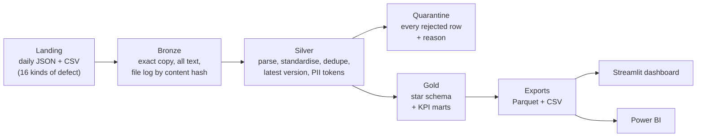
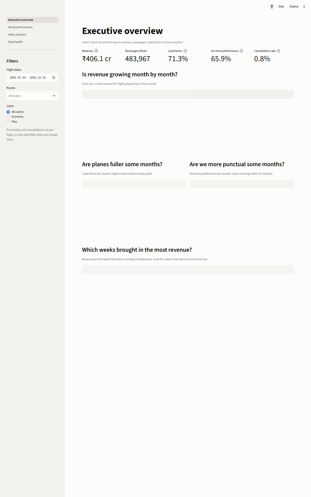
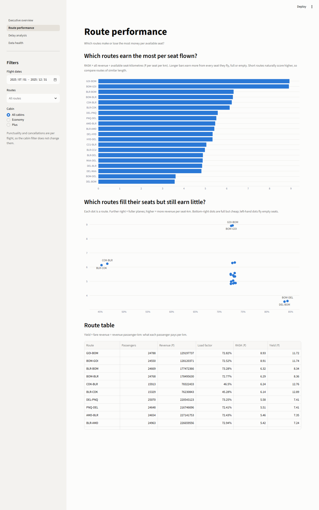
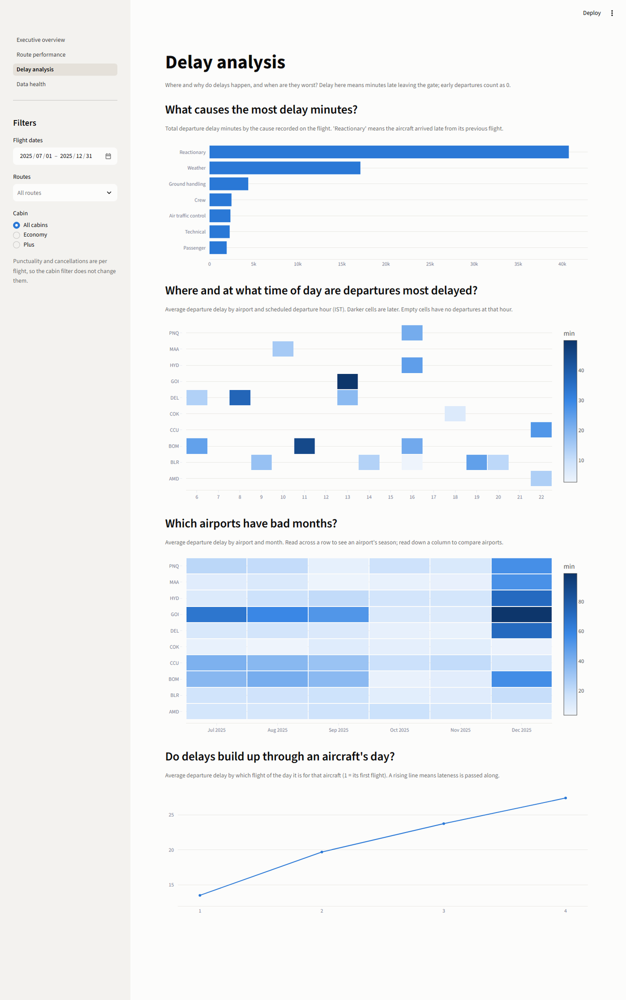
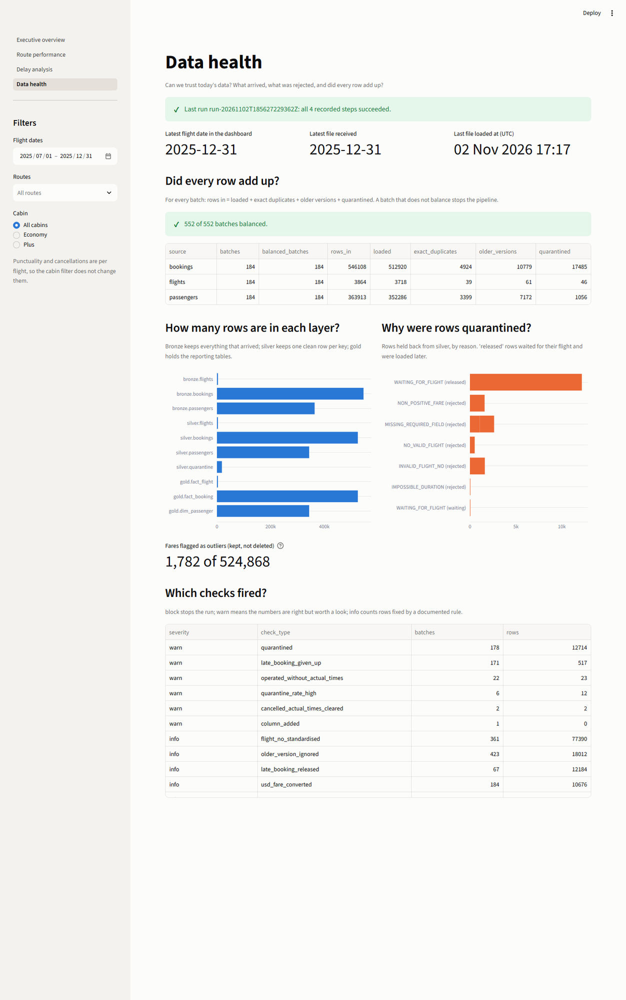

# Nova Air operations pipeline

An end-to-end batch data pipeline for **Nova Air**, a fictional Indian low-cost airline.
It takes six months of messy daily operational files (flights, bookings, passenger
profiles) and turns them into a trusted star schema, KPI marts and an interactive
dashboard, with every bad row accounted for.

All data is **synthetic**, generated by `scripts/generate_data.py`. Names, emails and
phone numbers are fake (Faker), but the pipeline treats them as real personal data.

It answers four questions:

1. How is the airline doing on revenue, passengers, load factor and on-time performance?
2. Which routes make or lose the most money per available seat?
3. Where and why do delays happen, and when are they worst?
4. Can we trust today's data?

## Architecture



Every run reconciles each batch (rows in = loaded + duplicates + older versions +
quarantined) and stops with a non-zero exit code if anything is unaccounted for.
Details: [`docs/ARCHITECTURE.md`](docs/ARCHITECTURE.md).

Stack: Python 3.11+, DuckDB with plain `.sql` files, Parquet, Streamlit + Plotly,
pytest, GitHub Actions. No Airflow, dbt, Spark or cloud: see
[`DECISIONS.md`](DECISIONS.md) for why, and [`docs/SCALING.md`](docs/SCALING.md) for
when they would be worth it.

## Dashboard

| Executive overview | Route performance |
|---|---|
|  |  |
| **Delay analysis** | **Data health** |
|  |  |

## Quick start

You need Python 3.11 or newer and about 1 GB of free disk space.

**1. Set up** (Windows, PowerShell):

```bash
py -3.11 -m venv .venv
```

```bash
.venv\Scripts\Activate.ps1
```

macOS or Linux:

```bash
python3.11 -m venv .venv && source .venv/bin/activate
```

Then, on any OS:

```bash
python -m pip install -r requirements-dev.txt
```

**2. Create your secret key.** Copy `.env.example` to `.env`, then make a key and paste
it after `NOVA_PII_KEY=` in `.env`:

```bash
python -c "import secrets; print(secrets.token_hex(32))"
```

**3. Check the setup:**

```bash
python -m scripts.check_env
```

**4. Generate the data** (about a minute):

```bash
python -m scripts.generate_data
```

**5. Run the pipeline** for all 184 days (3 to 5 minutes on the 4-core test laptop; see
[benchmarks](docs/BENCHMARKS.md)):

```bash
python -m pipeline.run --start 2025-07-01 --end 2025-12-31
```

**6. Open the dashboard:**

```bash
streamlit run dashboard/app.py
```

**Tests and lint:**

```bash
pytest -q
```

```bash
ruff check .
```

Other commands: one day `python -m pipeline.run --date 2025-07-01`; rebuild silver and
gold from bronze `python -m pipeline.run --full-refresh`; profile the raw files
`python -m scripts.profile_landing --defects`; benchmarks `python -m scripts.benchmark`.

## Results

From the latest run (small profile, seed 42), filled in by
`python -m scripts.update_doc_numbers`:

<!-- numbers:headline-kpis -->
| KPI | Value (1 Jul - 31 Dec 2025, small profile, seed 42) |
|---|---|
| Flights scheduled | 3,680 |
| Passengers flown | 483,967 |
| Revenue (fares + ancillary) | ₹406.1 crore |
| Load factor | 71.3% |
| On-time performance | 65.9% |
| Cancellation rate | 0.82% |
| Average arrival delay, all measured flights | 22.8 min |
| Average arrival delay, delayed flights only | 59.5 min |
| RASK | ₹5.24 per seat-km |
| Yield | ₹6.96 per passenger-km |
| Ancillary share of revenue | 2.8% |
<!-- /numbers -->

<!-- numbers:run-facts -->
- Source rows processed: **913,885** across **552** daily batches (546,108 booking rows).
- Batches that reconciled exactly: **552 of 552**.
- Rows held in quarantine: **18,587**, of which **12,184** were late bookings later released automatically.
<!-- /numbers -->

What the dashboard reveals (spoilers in
[`docs/GENERATOR_ANSWER_KEY.md`](docs/GENERATOR_ANSWER_KEY.md)): a busy route that is
full but earns the least per seat, a route that never fills, monsoon and fog delay
seasons, delays building up through each aircraft's day, and a festival revenue spike.

## Data quality

Sixteen kinds of defect are planted at known rates: duplicates, several versions of one
record, flight-number variants and corruptions, three timestamp formats in two time
zones, overnight flights with time-only arrivals, impossible durations, status/time
contradictions, zero and negative fares, USD fares, fare outliers, bookings that arrive
before their flight, bookings for flights that never exist, missing values, a new column
appearing mid-period, and next-day corrections. Each has a detection rule, an action, a
count and a test: [`docs/DATA_QUALITY.md`](docs/DATA_QUALITY.md).

## Repository map

```
config/pipeline.toml   sources, keys and rule values
pipeline/              runner, bronze, silver, gold, checks, PII tokens, logging
sql/                   meta/, silver/, gold/ - one readable file per step or table
dashboard/             Streamlit app; queries.py holds every query it runs
scripts/               data generator, profiler, benchmark, doc numbers, mock hackathon
tests/                 pytest suite on small hand-written fixtures
docs/                  start with docs/00_START_HERE.md
```

## Learning docs

Start with [`docs/00_START_HERE.md`](docs/00_START_HERE.md). Also:
[architecture](docs/ARCHITECTURE.md), [execution flow](docs/EXECUTION_FLOW.md),
[concepts](docs/CONCEPTS.md), [ETL vs ELT](docs/ETL_VS_ELT.md),
[data dictionary](docs/DATA_DICTIONARY.md), [SQL patterns](docs/SQL_PATTERNS.md),
[interview Q&A](docs/INTERVIEW_QA.md), [hackathon playbook](docs/HACKATHON_PLAYBOOK.md),
[practice drills](docs/PRACTICE_DRILLS.md), [change drills](docs/CHANGE_DRILLS.md),
[scaling](docs/SCALING.md), [Power BI guide](docs/POWER_BI_GUIDE.md),
[benchmarks](docs/BENCHMARKS.md), [decisions](DECISIONS.md).

## Limitations

- Raw personal data still exists in landing and bronze, inside the same DuckDB file as
  silver and gold. Production would separate them (see `docs/ARCHITECTURE.md`).
- Gold is rebuilt in full every run; fine at this size, not at 100x.
- The data is synthetic; its patterns were planted, so "findings" demonstrate the method,
  not facts about any airline.
- Benchmarks come from one laptop; your timings will differ.
- The Power BI guide's DAX was written for, but not tested in, Power BI.
