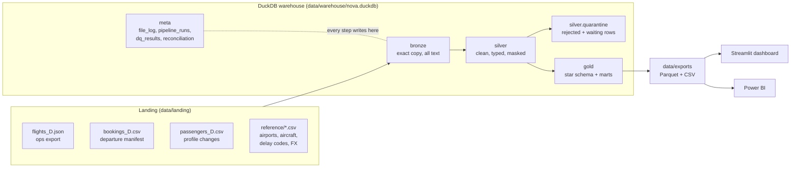
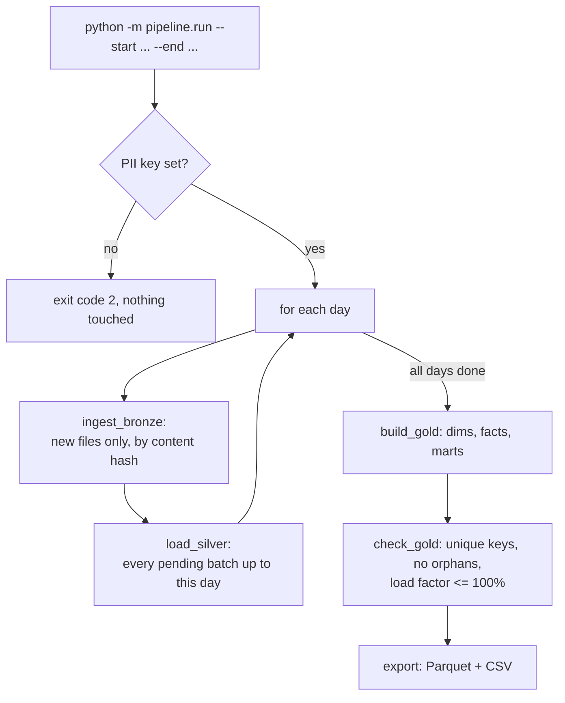
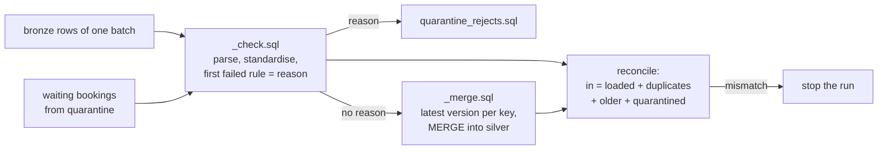
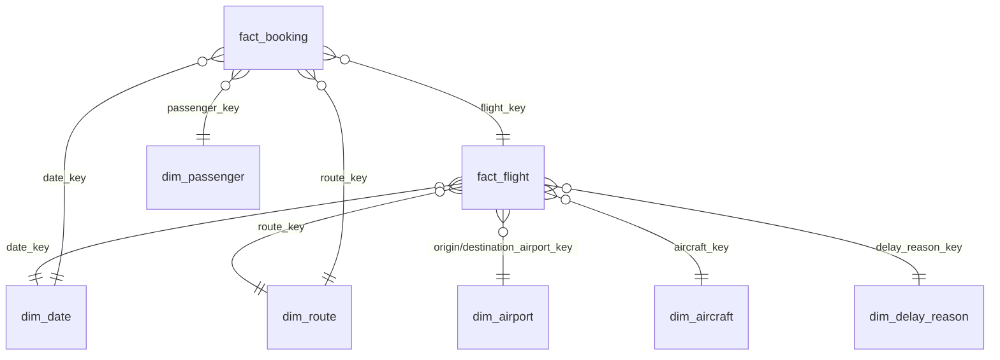

# Architecture

## The whole thing in one picture

## Why layers at all?

Think of a restaurant kitchen. Deliveries arrive at the back door and are kept exactly
as they came (you might need to complain to the supplier). Then ingredients are washed,
trimmed and sorted; anything rotten goes in a separate bin with a note saying why. Only
then are dishes assembled for customers. Nobody cooks straight from the delivery box.

A data pipeline works the same way. This layering is called the **medallion
architecture**, and its three layers are named bronze, silver and gold.

| Layer | Kitchen version | In this project | Rule |
|---|---|---|---|
| **Landing** | The delivery at the door | `data/landing/`, one file per source per day | Never edited |
| **Bronze** | The delivery, logged and shelved | `bronze.flights`, `bronze.bookings`, ... every field as text, plus `_source_file`, `_batch_id`, `_ingested_at`, `_row_number` | Insert only; never updated or deleted |
| **Silver** | Washed, trimmed, sorted ingredients | `silver.flights`, `silver.bookings`, `silver.passengers`, reference tables, `silver.quarantine` | One clean row per business key; failures go to quarantine with a reason |
| **Gold** | Dishes for customers | `gold.dim_*`, `gold.fact_*`, `gold.mart_*` | Shaped for questions; rebuilt every run |
| **Exports** | The pass to the dining room | `data/exports/gold/*.parquet|csv`, `data/exports/meta/*.parquet` | What the dashboard and Power BI read |

Why bronze keeps everything as text: if bronze tried to turn `"N?1234"` or
`"not-a-time"` into a number or a timestamp, the load would fail and you would lose the
evidence. Text can hold anything, so loading never fails, and judging the values is
silver's job.

## What runs, in what order

Each box is a **step**. The runner (`pipeline/run.py`) keeps them in a plain tuple, and
each step names the steps it depends on. Every step:

1. runs inside **one transaction**, so it either fully happens or leaves the warehouse
   untouched;
2. writes one row to `meta.pipeline_runs` (status, seconds, rows in, rows out, rows
   quarantined);
3. logs `event=step_finished step=... seconds=... rows_in=...`.

A failure rolls the step back, records the failure, and the command exits with code 1.

## Silver in more detail

For each batch (one file), in date order, flights then passengers then bookings:

Personal data is tokenised **inside the first SQL step**, before anything else reads it,
so neither silver nor the quarantine ever holds a raw value.

## Gold: a star schema

A **star schema** puts the numbers you add up (facts) in the middle and the things you
filter and group by (dimensions) around them, like the points of a star.

Two **marts** sit on top, pre-summed for the dashboard: `mart_flight_daily` (date x route)
and `mart_booking_daily` (date x route x cabin). They hold totals only. Every ratio is
calculated after filtering, as sum / sum. See `DATA_DICTIONARY.md` for every column.

## Where personal data lives, and the honest limitation

| Place | Personal data? |
|---|---|
| `data/landing/` | Yes, raw (that is what arrived) |
| `bronze.*` | Yes, raw (exact copy) |
| `silver.*`, `silver.quarantine` | No: tokens, an age band, nothing else |
| `gold.*`, exports, dashboard | No |

**Limitation:** bronze lives in the same DuckDB file as silver and gold, so anyone who
can open the file can read raw PII. In production you would:

- keep landing and bronze in a separate storage location (a separate bucket or
  database) that only the pipeline's service account can read;
- give analysts access to silver and gold only;
- keep the HMAC key in a secrets manager, not a `.env` file, and rotate it with a plan
  (rotating changes every token, so joins across the rotation need a mapping);
- set a retention period for landing and bronze, after which raw files are deleted.

## Files and what they do

| File | Job |
|---|---|
| `pipeline/run.py` | Command line, the ordered steps, one transaction per step |
| `pipeline/settings.py` | Paths, rule values from `config/pipeline.toml`, the PII key (fails if missing) |
| `pipeline/db.py` | Connect; run a `.sql` file statement by statement with `$name` parameters |
| `pipeline/bronze.py` | Find files, fingerprint them, create/extend bronze tables, load as text |
| `pipeline/silver.py` | Process pending batches through the silver SQL; count and reconcile |
| `pipeline/pii.py` | The HMAC-SHA256 token function, registered so SQL can call `pii_token()` |
| `pipeline/checks.py` | Record check results; stop the run on blocking failures |
| `pipeline/gold.py` | Rebuild gold in order, check keys and orphans, export |
| `pipeline/logs.py` | `key=value` log lines and `meta.pipeline_runs` rows |
| `sql/meta/*.sql` | Meta tables; dashboard summary tables |
| `sql/silver/*.sql` | Macros, tables, the check and merge files per source |
| `sql/gold/*.sql` | One file per gold table, grain stated at the top |
| `dashboard/*` | Streamlit app; `queries.py` holds every SQL query it runs |
| `scripts/*` | Data generator, profiler, benchmark, doc numbers, mock brief |
