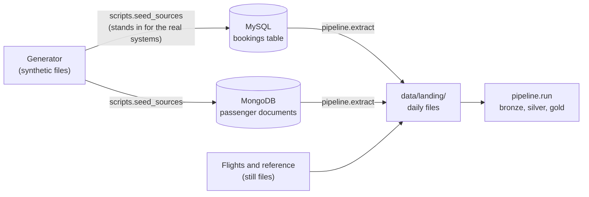

# Optional source systems: MySQL and MongoDB

By default the pipeline reads daily files from `data/landing/`. A real airline would not
start from files: bookings live in a reservation database and passenger profiles in a
customer app. This optional path reads them from there instead, and writes the same
daily files, so **bronze, silver and gold do not change at all**.



| System | Holds | Why this system |
|---|---|---|
| **MySQL** | `bookings`: one row per delivered booking record, plus `file_date` | Booking records are rows with a fixed set of columns |
| **MongoDB** | `passengers`: one document per profile record, with `email` and `phone` nested under `contact` | A customer profile is a nested document, and `extract` flattens it back to the file's columns |

The data is synthetic, so `scripts/seed_sources.py` plays the part of the live systems:
it loads the generator's files into MySQL and MongoDB **as text exactly as delivered**, so
the planted defects (duplicates, bad dates) survive and the pipeline's own rules still
have something to catch. In a real system the columns would be typed.

## Run it

1. Install the optional drivers: `pip install -r requirements-sources.txt`.
2. Create a MySQL user and database (as the MySQL root user, once):

   ```sql
   CREATE DATABASE nova_source;
   CREATE USER 'nova_etl'@'localhost' IDENTIFIED BY 'pick-your-own-password';
   GRANT ALL PRIVILEGES ON `nova\_source%`.* TO 'nova_etl'@'localhost';
   ```

   The `%` lets the tests use a throwaway `nova_source_test` database.
3. Put the password in `.env` (see `.env.example`), and start MongoDB on its default port.
4. Fill the sources, extract a day, and run the pipeline on it:

   ```bash
   python -m scripts.seed_sources
   python -m pipeline.extract --date 2025-07-01
   python -m pipeline.run --date 2025-07-01
   ```

   The extract rewrites that day's bookings and passengers files in `data/landing/`.
   Flights and the reference files are not in a database and stay as they are.

## How it is checked

`tests/test_extract.py` seeds the fixtures into throwaway databases and checks that every
extracted file has the same header and rows as the fixture file it came from, and that
seeding twice does not duplicate anything. The tests are skipped when a server is not
running, so the default test run and CI need neither database.

## Limits

- Extraction is one whole day at a time (`WHERE file_date = day`), not a running
  watermark over changed rows. Re-extracting a day gives the same file.
- A bookings column that is NULL for every row of a day is treated as "not in that
  day's file", because it was added to the table later (the generator adds
  `promo_code` partway through).
- Both servers run on one laptop with no authentication on MongoDB. This shows the
  integration, not production access control.
